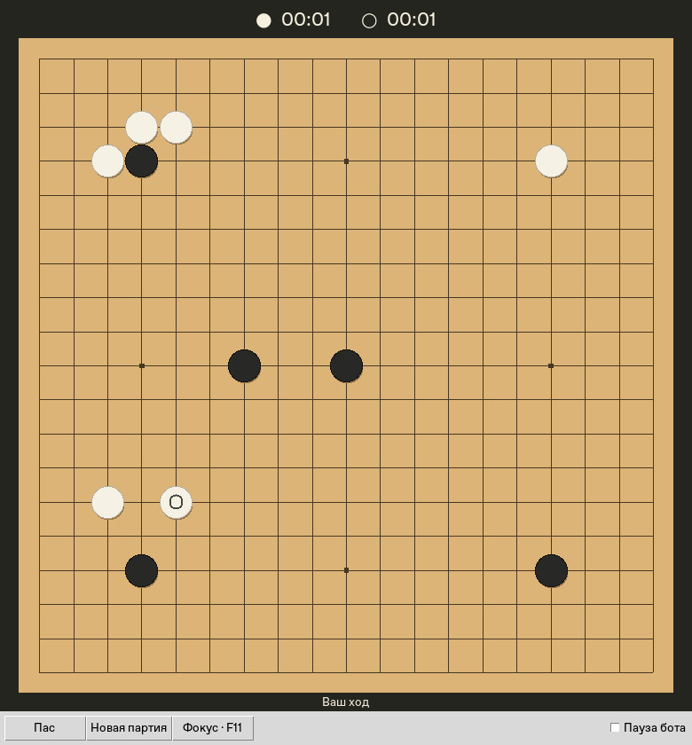

# Go Masters AI

Offline-first Go training and play. The first playable desktop prototype uses KataGo Human SL on a 19×19 board. It includes a Russian interface and a choice of opponent rank. Individual master profiles and Android play are under development.

## Play on desktop

Windows x64 or Debian-compatible Linux x64, AVX2/FMA CPU, Python 3.10+ with Tk. On Linux, the setup also uses `dpkg-deb`. Open a terminal in the repository and run:

```sh
python scripts/play.py --setup
python scripts/play.py
```

On Windows the Python launcher also accepts `py` in place of `python`. Setup fetches checksum-pinned engine and model files once (about 120 MB on Windows, 155 MB on Linux). Later launches open the board offline. To play White against the 3k Human SL profile with no display delay:

```sh
python scripts/play.py --color W --rank 3k --delay 0
```

Click an intersection to play. Pass with **Пас**. Press **F11** for the board and clocks alone. Click a clock or press **Esc** to return. New game starts a fresh position and cancels any pending reply. Clocks display time used by each side. Two passes end the game with KataGo's score estimate.



[Отчёт первой игровой сборки](docs/FIRST_PLAY.ru.md) · [План](docs/PLAN.ru.md) · [Architecture](docs/ARCHITECTURE.md) · [Sources](docs/SOURCES.md) · [Validation](docs/VALIDATION.md)

## Quick start (Python 3.10+)

```sh
python -m pip install -e .
python -m unittest discover -s tests -v
python -m gomasters.demo
```

The demo samples synthetic policy probabilities only. It does not play a full game. No dependencies are required for these tests. For real positions, install KataGo, a standard model, Human SL model and the matching upstream analysis config; then run:

```sh
python -m gomasters.engine --exe /path/to/katago --config /path/to/analysis_example.cfg --model /path/to/main.bin.gz --human-model /path/to/b18c384nbt-humanv0.bin.gz --rank 5k
```

The command requests the empty 19x19 board and samples a legal move from humanPolicy. The one-shot JSON probe and the persistent GTP game client were both exercised with real models. Use `--help` for more options.

## Material acquisition (online once)

```sh
python scripts/fetch_sources.py --list
python scripts/fetch_sources.py --get cwi-sgf --acknowledge-terms
python scripts/fetch_sources.py --clone katago katrain katadroid sabaki kaya igoki izis --acknowledge-terms
```

Read the source register first. Downloads are cached under external/ (ignored by Git); upstream repositories retain their history and licenses. The script records SHA-256 for archives and exact Git commit hashes for clones. It does not automatically execute third-party code or extract archives. PAGE and model weights require manual selection/download from their official pages. Check each source's terms before redistributing. Never add restricted data or multi-GB weights to normal Git history.

## Repository

https://github.com/MurasakibaraTanuki/Go-game-agent-

Clone this repository for local development. The repository is public; do not commit private game histories or materials without redistribution permission.

## SGF corpus

```sh
python -m pip install -e ".[corpus]"
python scripts/fetch_sources.py --get cwi-sgf --acknowledge-terms
python scripts/index_sgf.py external/cwi-sgf.tgz external/cwi.sqlite
```

The index streams archive members, reads main lines, excludes handicap/setup and non-19×19 games, and rebuilds a local SQLite file atomically. Its report lists duplicates and skipped records. See the session report for the observed counts and limits of deduplication.
